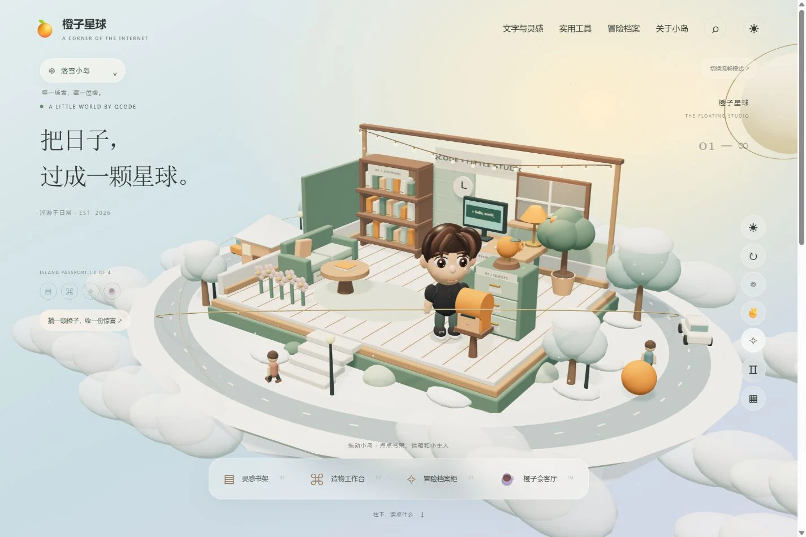
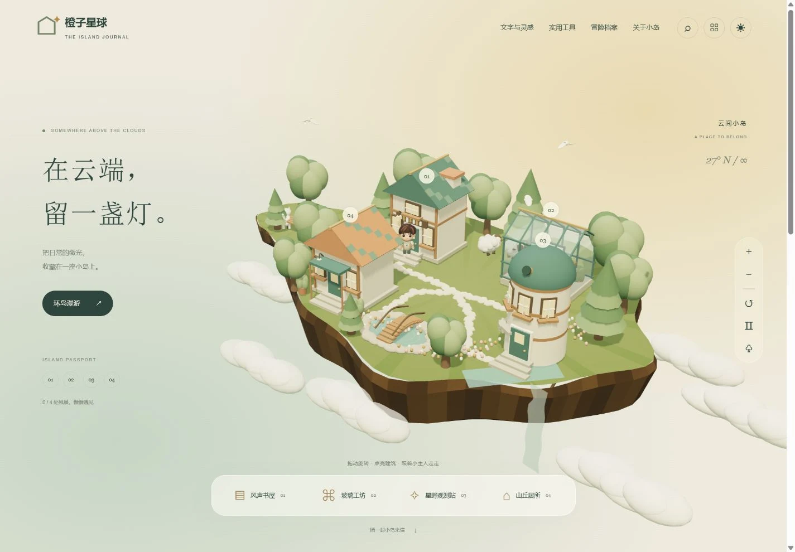

# Notion 3D Themes

One Next.js project, two explorable Three.js themes: **Orange Studio** and **Island Village**. Built on [NotionNext](https://github.com/notionnext-org/NotionNext), with Notion-powered articles and Vercel deployment.

[中文说明](./README.md) · [Orange demo](https://qcode.im/?theme=orange) · [Island demo](https://qcode.im/?theme=island) · [Use this template](https://github.com/cmerber/notion-3d-themes/generate)




Includes walking characters, animals, weather in Orange, camera transitions, day/night modes, mobile controls, startup covers, WebGL fallbacks, and matching article/archive/search/tool/about layouts. Screenshots show the author's live demo; customize site identity and content after forking.

## Run

Use Node.js 22 and the pinned Yarn 1.22.22:

```bash
corepack enable
corepack yarn install --frozen-lockfile
corepack yarn dev
```

Open `http://localhost:3000`. No account or API key is needed for the included local demonstration content. Preview `/?theme=orange` or `/?theme=island`; Orange is the default.

## Make it yours

Copy `.env.example` to `.env.local`, then configure your own public NotionNext database with `NOTION_PAGE_ID`. Leaving it empty keeps the local demo. Set `NEXT_PUBLIC_SITE_TITLE`, `NEXT_PUBLIC_AUTHOR`, `NEXT_PUBLIC_BIO`, `NEXT_PUBLIC_LINK` and `NEXT_PUBLIC_THEME`. A Notion Config `THEME` entry takes precedence over the environment setting.

Customize shared identity in [`site.config.js`](./site.config.js) and scene settings in `themes/orange/config.js` and `themes/island/config.js`. Replacing the profile image does not regenerate the procedural 3D character; edit the theme's `scene/createCharacter.js` for that.

Import your fork into Vercel as a Next.js project using Node.js 22. Optional services remain unconfigured until you supply your own credentials. See [configuration](./docs/configuration.md), [integrations](./docs/integrations.md) and [development](./docs/development.md).

MIT licensed, with the upstream license and attribution retained. See [LICENSE](./LICENSE) and [NOTICE](./NOTICE).
